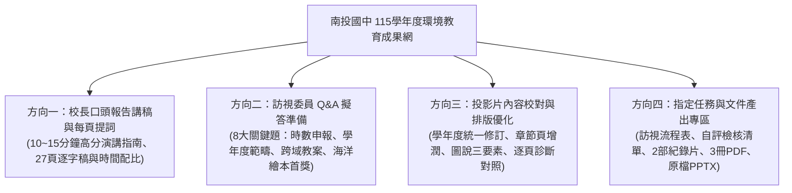

# 南投縣立南投國民中學 115學年度環境教育考評成果旗艦網
> **永續投中 · 綠色共好** ｜ 115學年度環境教育考評複評 到校訪視輔導旗艦平台  
> 報告人：劉松彥 校長 ｜ 訪視輔導日期：115 年 11 月 2 日 (一)  
> 線上展示網址（GitHub Pages）：**[https://yaoshuchin.github.io/115-nantou-jh-eco-education/](https://yaoshuchin.github.io/115-nantou-jh-eco-education/)**

---

## 🌟 網站四大核心呈現方向

本網站針對南投國中 **115學年度環境教育考評複評到校訪視輔導** 量身打造，全方位以**四大呈現方向**為核心骨幹，整合 **27 頁全彩簡報**、**110 張真實佐證照片**、**2 部高畫質專題紀錄片**、**3 冊全彩出版成果電子書**與**全景綠校園海報**：

---

### 🎙️ 方向一：校長口頭報告講稿／每頁提詞重點
* **建議報告總長**：12 分鐘（保留 5~8 分鐘委員雙向交流）。
* **四大黃金心法**：開門見山破題、頂尖亮點語調自豪、動人故事溫暖人心、嚴格控時不拖泥帶水。
* **27 頁逐頁提詞卡**：包含建議秒數、必提亮點關鍵字、口語化逐字稿與上台眼神儀態提示（如：第 15 頁 AI 太陽能小車佳作、第 16 頁特教開心農場、第 25 頁第三屆全國海洋科普繪本首獎《鯨喜》）。

---

### 💬 方向二：輔導訪視委員常見提問與 Q&A 擬答準備
精選 8 大評鑑核心考題，解析**委員評鑑意圖**與**最佳回答策略**，並提供官方正式擬答：
1. **法定時數**：全員 4 小時法定環教時數落實度與提報系統 100% 達成率。
2. **學年度界定**：封面標示 115 學年度與內頁 114 學年度之範疇釐清。
3. **專責人員認證**：依環境教育法第 18 條規定取得認證之效期與回訓機制。
4. **跨領域真融入**：特教班開心農場實作、自然綠能與英語習慣調查之評量回饋。
5. **全國海洋繪本拔尖**：內陸南投學子勇奪教育部第三屆海洋科普繪本首獎《鯨喜》與第三名之培育歷程。
6. **走入社區**：易經大學徒步淨山、街區減塑淨街與社區里民回饋。
7. **校園生態與防蚊**：原生水生生態池生物防治與每週巡倒清刷病媒蚊防治之平衡。
8. **永續與經費**：短中長程發展藍圖與自籌外部計畫補助經費籌措。

---

### 🔍 方向三：投影片內容校對與排版優化建議
針對 `115南投國中_環境教育考評複評到校輔導.pptx` 進行逐頁深度健檢：
* **學年度統一**：統一定位為「114-115學年度推動成果匯報」，避免時序混淆。
* **章節轉場頁視覺豐富化**：Slide 3, 8, 14, 20, 26 增補核心成效提要與指標編號。
* **圖說三要素補強**：補齊活動時間（年月）、對象年級、參與人次與核心素養。
* **頂尖榮譽視覺放大**：將全國第一名《鯨喜》放大標註金色標章，增強視覺衝擊力。
* **逐頁改善對照表**：完整列出第 1 至 27 頁的現狀問題、修潤文案與排版建議。

---

### 📂 方向四：其他指定任務與文件產出專區
* 🎥 **2 部官方高畫質專題紀錄片（支援線上播放與下載）**：
  1. 《南投國中：環境教育的典範》（45 MB）
  2. 《南投國中超狂環保課：從太陽能車到復古嘉年華》（9.5 MB）
* 📖 **3 冊全彩出版成果電子書（支援線上閱讀與下載）**：
  1. 《南投國中綠色校園永續旅程》成果手冊（36 MB）
  2. 《南投國中綠色永續手札》專題手札（32.8 MB）
  3. 《綠色校園永續剪貼簿》精華圖文剪貼簿（39.6 MB）
* 🗺️ **《南投國中永續綠校園》全景旗艦海報**（5.7 MB，支援大圖燈箱檢視）。
* 📥 **原始簡報下載**：`115南投國中_環境教育考評複評到校輔導.pptx` 原檔（37.1 MB）。
* 🗓️ **115年11月2日 訪視輔導作業流程備忘表**。
* ✅ **考評現場書面與實體佐證自評檢核表**。
* 🖼️ **110 張真實活動佐證相片庫**。

---

## 🏫 學校聯絡資訊

- **學校全銜**：南投縣立南投國民中學 (Nantou Junior High School)
- **校長**：劉松彥 校長
- **校址**：540 南投縣南投市祖祠路 360 號
- **電話**：(049) 222-2549
- **成果編製**：南投國中環境教育推動小組
